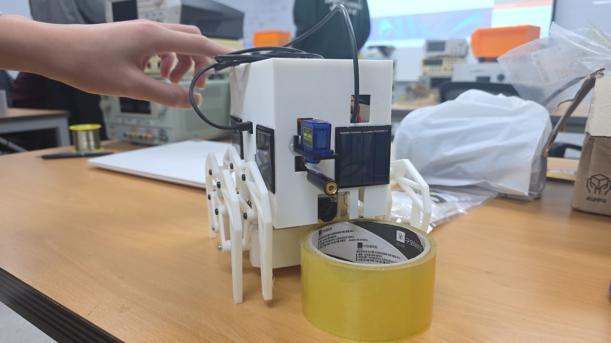
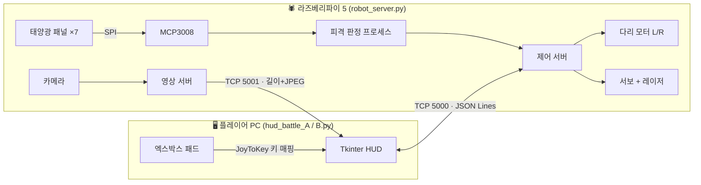
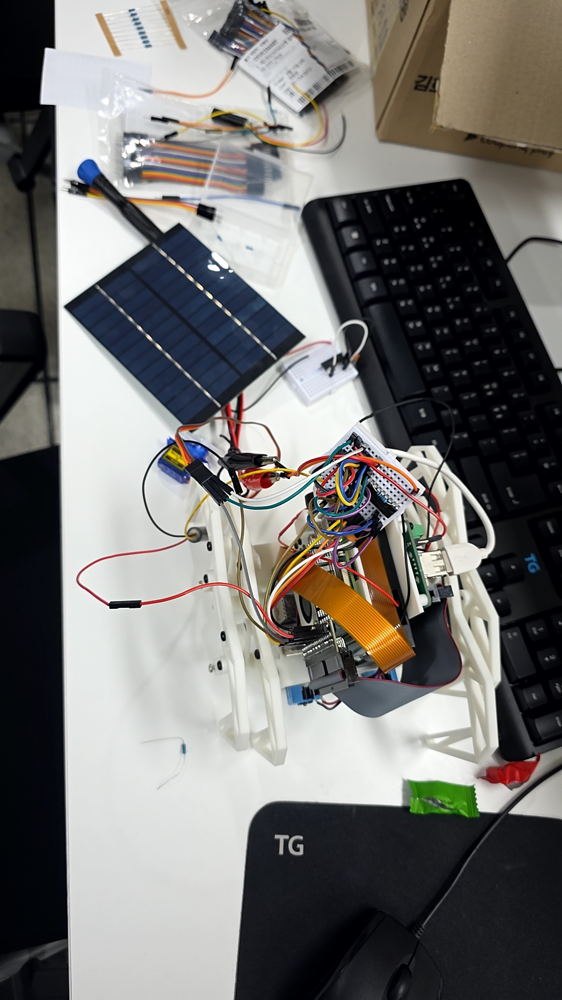
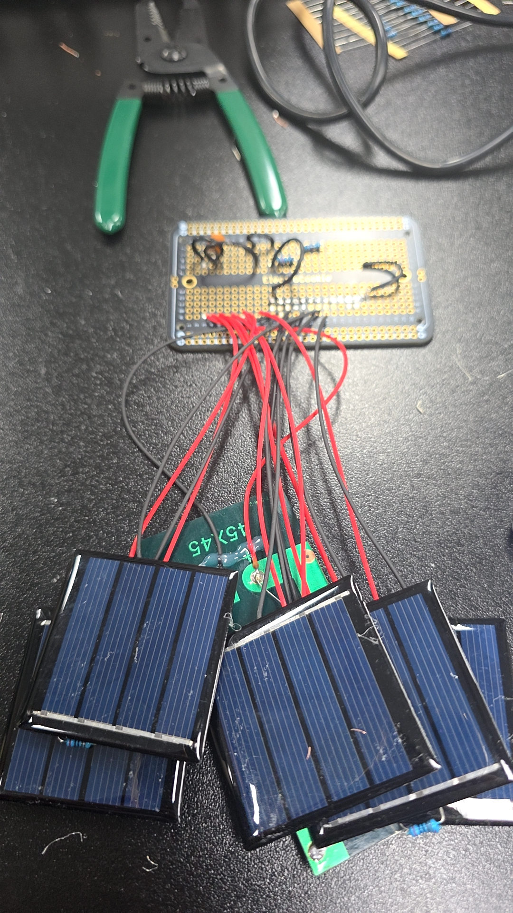
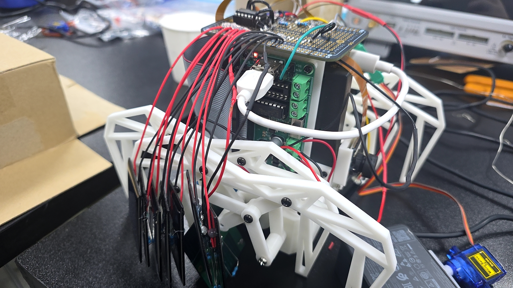

# 🕷️ 레이저 배틀 거미로봇 (Laser Battle Spider Robot)

> 라즈베리파이 5 기반 거미로봇 두 대가 **레이저로 서로를 맞히는 1:1 대전 게임**과 **카메라로 보며 통과하는 미로 모드**를 즐길 수 있도록 만든 프로젝트입니다.
> 태양광 패널을 피격 센서로 쓰고, 레이저를 **25Hz / 35Hz로 깜빡여 쏘는 방식**으로 내 레이저에는 맞지 않도록 설계했습니다.

<p align="center">
  
</p>
<p align="center"><sub>완성된 로봇: 앞면에 서보에 단 레이저와 카메라, 옆면에 피격 센서용 태양광 패널</sub></p>

<br>

## 📌 목차
1. [프로젝트 개요](#-프로젝트-개요)
2. [주요 기능](#-주요-기능)
3. [시스템 구조](#-시스템-구조)
4. [하드웨어](#-하드웨어)
5. [핵심 기술: 주파수 변조 피격 판정](#-핵심-기술-주파수-변조-피격-판정)
6. [통신 프로토콜](#-통신-프로토콜)
7. [실행 방법](#-실행-방법)
8. [조작법](#-조작법)
9. [트러블슈팅](#-트러블슈팅)
10. [한계와 개선할 점](#-한계와-개선할-점)
11. [폴더 구조](#-폴더-구조)

<br>

## 📖 프로젝트 개요

| 항목 | 내용 |
|---|---|
| 기간 | 2026.06 ~ 2026.11 |
| 인원 | 3명 |
| 내 역할 | 배선 설계, 피격 판정 알고리즘, 납땜 및 로봇 연결 작업 |
| 사용 기술 | Python, Raspberry Pi 5, gpiozero / lgpio, spidev, picamera2, Tkinter, TCP 소켓 |
| 하드웨어 | Raspberry Pi 5, 모터 드라이버 기판, SG90 서보, 레이저 모듈, 소형 태양광 패널 ×7, MCP3008 ADC |

### 만든 이유
- 레이저 태그처럼 **실물 로봇끼리 싸우는 게임**을 만들고 싶었습니다.
- 별도의 적외선 수신기 대신 **태양광 패널을 빛 센서로** 활용해, 맞으면 측정값이 튀는 원리로 피격을 판정했습니다.
- 플레이어는 PC 화면(HUD)에서 로봇 카메라 영상을 보며 **엑스박스 패드로 조종**합니다.

<br>

## ✨ 주요 기능

- **전투 모드**: 로봇 카메라 영상 + 체력/레이저 HUD. 상대 레이저에 맞으면 체력 -1
- **미로 모드**: 카메라 영상 + 제한 시간 타이머. 레이저 발사·조준·피격은 PC와 로봇 **양쪽에서 모두 차단**
- **본인 피격 방지**: A 로봇은 25Hz로 쏘고 35Hz만 감지, B 로봇은 반대 → 반사광이나 배선 노이즈로 자기 레이저에 맞지 않음
- **리셋 직후 보호**: 리셋·모드 전환 직후 잠깐 동안은 피격을 무시해, 대기 중 쌓인 값으로 가짜 피격이 뜨지 않음
- **실시간 영상 스트리밍**: 640×320 JPEG, 초당 약 20프레임
- **안전장치(워치독)**: PC 조종 신호가 0.5초 끊기면 로봇이 스스로 모터를 멈추고 레이저를 끔
- **자동 재연결**: 와이파이가 끊겨도 PC가 다시 접속
- **오프라인 연습 모드**: 로봇에 연결되지 않으면 가상 화면으로 연습 가능

<br>

## 🧩 시스템 구조



- 로봇이 **서버**, PC가 **클라이언트**입니다. 플레이어마다 PC 1대 + 로봇 1대가 짝을 이룹니다.
- 피격 판정은 측정 속도를 보장하기 위해 **별도 프로세스(multiprocessing)** 로 돌립니다.

<br>

## 🔌 하드웨어

### 핀 배치 (Raspberry Pi 5)

| 부품 | GPIO (물리 핀) | 비고 |
|---|---|---|
| 오른쪽 다리 모터 | 앞 GPIO7 (26) / 뒤 GPIO8 (24) / 속도 GPIO25 (22) | 모터 드라이버 기판 |
| 왼쪽 다리 모터 | 앞 GPIO20 (38) / 뒤 GPIO21 (40) / 속도 GPIO16 (36) | |
| 서보 신호 | GPIO18 (12) | 하드웨어 PWM 50Hz |
| 레이저 신호 | GPIO23 (16) | |
| MCP3008 | SCLK (23) · MISO (21) · MOSI (19) · CS = **GPIO24 (18)** | SPI0 |
| 태양광 패널 | MCP3008 CH0~CH7 중 7채널 | 패널마다 2kΩ 부하 저항 |

### 패널 채널 (로봇마다 7장 사용)

처음에는 MCP3008의 8채널에 맞춰 패널 8장을 붙일 계획으로 기판을 8자리 모두 납땜했습니다. 그런데 3D 프린팅으로 케이스를 만들고 보니 **패널 한 장을 넣을 자리가 부족**해서, 로봇마다 한 자리를 비우고 7장만 장착했습니다. 코드는 `robot_server.py`의 `PANELS` 값만 로봇에 맞게 바꾸면 되도록 만들어 두었습니다.

| 로봇 | 빠진 패널 | `PANELS` 설정 |
|---|---|---|
| 1번 (A) | P6 (CH5) | `[0, 1, 2, 3, 4, 6, 7]` |
| 2번 (B) | P1 (CH0) | `[1, 2, 3, 4, 5, 6, 7]` |

### 설계 포인트
- **SPI CS 핀 충돌 해결**: 모터가 GPIO7·8(SPI CE1·CE0)을 이미 쓰고 있어서, `dtoverlay=spi0-0cs`로 하드웨어 CS를 끄고 **GPIO24를 코드에서 직접 CS로 제어**했습니다.
- **전원 분리**: 서보는 순간 전류가 커서 파이 5V가 아니라 **모터 기판의 5V(J9)** 에서 전원을 받고, GND는 파이와 공통으로 묶었습니다. 서보 전원단에 470µF 전해 커패시터, MCP3008 전원단에 0.1µF 세라믹 커패시터를 달았습니다.
- **만능기판 납땜**: 브레드보드 시제품을 하프 사이즈 만능기판으로 옮겼습니다. 파이·5V 연결부는 암 핀헤더, 서보·레이저는 수 핀헤더로 만들어 **분리·교체가 쉽게** 했고, 패널도 헤더 커넥터로 뗐다 붙일 수 있게 했습니다.
- **3D 프린팅 케이스**: Python 스크립트로 치수를 넣으면 STL·3MF가 생성되도록 만들었습니다. 통·뒷판·뚜껑·서보 받침 4개 부품이고, 패널 홈, 패널 선을 밀어 넣는 홈, 카메라·USB-C·레이저·서보 선 구멍, 레이저 높이(패널 띠 중앙)를 반영했습니다. 4개 부품은 출력 방향으로 놓인 채 한 파일(`spider_case_all`)로 합쳐 두었습니다. 부품끼리 겹치지 않는지, 뒷판·뚜껑이 걸리지 않고 끼워지는지도 스크립트로 검사했습니다. 로봇 1대에 PLA 약 115g이 들어갑니다.

### 제작 과정

| ① 브레드보드 시제품 | ② 패널 배선 | ③ 만능기판 장착 |
|:---:|:---:|:---:|
|  |  |  |
| 큰 태양광 패널 1장과 브레드보드로 피격 감지 원리를 먼저 검증 | 소형 패널마다 2kΩ 부하 저항을 달고 만능기판에 연결 | MCP3008을 올린 기판을 파이 위에 얹고 패널 선을 헤더로 연결 |

<br>

## 🎯 핵심 기술: 주파수 변조 피격 판정

처음에는 "패널 값이 갑자기 튀면 피격"으로 판정했지만, **그림자·조명 변화·자기 레이저 반사**까지 피격으로 잡히는 문제가 있었습니다. 그래서 레이저를 일정 주파수로 깜빡이고, **그 주파수 성분만 골라내는 방식**으로 바꿨습니다.

| 로봇 | 발사 주파수 | 감지 주파수 |
|---|---|---|
| A | 25Hz | 35Hz |
| B | 35Hz | 25Hz |

**판정 과정**
1. 패널 7장을 각각 **초당 250회** 측정합니다.
2. **0.2초 구간**마다 감지 주파수 성분의 세기와 위상(타이밍)을 계산합니다. 그림자처럼 한 방향으로 변하는 흐름은 먼저 빼고 계산합니다.
3. 시작 시 3초간 평소 잡음을 측정해 **기준값 = 잡음 × 3**으로 자동 보정합니다.
4. **3구간 연속**(약 0.6초) 조건을 만족하면 명중으로 인정합니다.
   - 첫 구간: 기준을 확실히 넘어야 함
   - 이후 구간: 기준의 50%만 넘어도 되지만, **깜빡임 타이밍(위상)이 ±60° 이내로 계속 일치**해야 함
5. 한 번 맞으면 1.5초 동안은 다시 세지 않아, 한 발이 여러 번 세어지지 않게 했습니다.

**결과**
- 갑작스러운 밝기 변화를 피격으로 잘못 잡는 경우가 시뮬레이션 기준 **약 1/10로 감소**했습니다.
- 처음엔 3구간 모두 엄격한 기준을 적용했더니 손 떨림으로 조준이 살짝만 흔들려도 판정이 끊겼습니다. 핵심인 "위상 일치"는 유지하고 세기 조건만 완화해 **오탐은 막으면서 명중률을 회복**했습니다.

<br>

## 📡 통신 프로토콜

Wi-Fi(PC 핫스팟) 위에서 **TCP 소켓 2개**로 통신합니다.

### 1) 조종 채널 — TCP 5000, JSON Lines (NDJSON)
메시지 하나 = JSON 한 줄(`\n` 구분)

| 방향 | 메시지 예시 | 설명 |
|---|---|---|
| PC → 로봇 | `{"t":"ctl","f":1,"b":0,"l":0,"r":0,"pan":12.5,"lock":0,"maze":0}` | 이동·서보 각도·모드. **초당 20회** 전송 |
| PC → 로봇 | `{"t":"fire"}` | 레이저 발사 (1초간 깜빡임) |
| PC → 로봇 | `{"t":"cal"}` | 패널 재보정 |
| 로봇 → PC | `{"t":"hello","id":"A","own":25,"enemy":35}` | 접속 시 로봇 정보 |
| 로봇 → PC | `{"t":"hit","panel":3}` | 명중 알림 |
| 로봇 → PC | `{"t":"ping"}` | 1초마다 연결 확인 |

### 2) 영상 채널 — TCP 5001, 길이 + JPEG
- 프레임마다 **4바이트 빅엔디언 길이**를 먼저 보내고 JPEG 데이터를 이어서 보냅니다.

### 로봇 내부 통신
| 연결 | 방식 |
|---|---|
| 파이 ↔ MCP3008 | SPI (CS는 GPIO24 소프트웨어 제어) |
| 파이 → 서보 | PWM 50Hz, 펄스 0.5~2.5ms |
| 레이저 → 상대 패널 | 광 신호 주파수 변조 (25 / 35Hz) |

<br>

## 🚀 실행 방법

### 라즈베리파이 (로봇)
```bash
# 1. 패키지 설치
sudo apt install python3-spidev python3-gpiozero python3-lgpio python3-picamera2

# 2. /boot/firmware/config.txt 에 추가 후 재부팅
dtparam=spi=on
dtoverlay=spi0-0cs
dtoverlay=pwm-2chan

# 3. robot/ 폴더의 파일을 파이 홈 폴더로 복사한 뒤
#    robot_id.txt 에 A(1번 로봇) 또는 B(2번 로봇)를 적고, PANELS 를 로봇에 맞게 설정

# 4. 배선 점검 후 실행
python3 check_pins.py
python3 robot_server.py
```
> ⚠️ 두 로봇의 `robot_id.txt`가 같으면 서로 맞혀도 피격이 되지 않습니다.
> 로봇이 켜질 때 3초간 패널 보정을 하니 그동안 레이저를 비추지 마세요.

### PC (플레이어)
```bash
py -m pip install pillow
py hud_battle_A.py      # 1번 로봇 플레이어
py hud_battle_B.py      # 2번 로봇 플레이어
```
로봇 IP는 각 HUD 파일 안의 `ROBOT_IP`에 적혀 있습니다. IP가 바뀌면 그 줄만 고치면 됩니다.

### 부품 테스트 (라즈베리파이)
| 파일 | 용도 |
|---|---|
| `check_pins.py` | 납땜 후 SPI·MCP3008 연결 점검 |
| `test_robot.py` | 패널 값, 레이저, 서보, 깜빡임 감지 테스트 메뉴 |
| `servo_test.py` / `servo_center.py` | 서보 동작 확인, 가운데 각도 맞추기 |
| `hit_probe.py` | 가짜 명중의 원인(조명, 모터·서보 잡음, 접촉 불량) 찾기 |

<br>

## 🎮 조작법

엑스박스 패드는 **JoyToKey**로 키보드 키에 매핑해서 사용합니다.

| 패드 | 키 | 동작 |
|---|---|---|
| 왼쪽 스틱 | ↑ ↓ ← → | 전진 / 후진 / 제자리 회전 |
| A | `1` | 레이저 발사 (쿨타임 5초) |
| LB / RB | `Q` / `W` | 레이저 좌우 조준 |
| Start | `4` | 전투 ↔ 미로 전환 |
| B | `5` | 미로 도착 표시 |
| X | `6` | 패널 재보정 |
| Y | `3` | 전체화면 |
| View | `R` | 리셋 |

**이동 규칙**: 두 다리 앞 = 전진 / 두 다리 뒤 = 후진 / 서로 반대 = 제자리 회전

<br>

## 🛠️ 트러블슈팅

| 문제 | 원인 | 해결 |
|---|---|---|
| ADC 값이 전부 0 | 납땜 시 **8열(MOSI)과 9열(CS)이 브릿지** → CS가 MOSI를 따라 흔들려 변환 실패 | 솔더윅으로 브릿지 제거, 멀티미터 통전 테스트로 확인 |
| 8번 패널만 1008(최대값) 고정 | 커넥터 교체 중 **부하 저항 누락 / 입력 플로팅** | 패널 가리기 테스트로 원인 분리 후 저항 재장착 |
| 서보 동작 시 파이 재부팅 위험 | 서보 순간 전류로 전압 강하 | 모터 기판 5V로 전원 분리 + 470µF 커패시터, `vcgencmd get_throttled` 로 확인 |
| 그림자·반사로 가짜 피격 | 단순 값 변화로 판정 | 주파수 변조 + 위상 일치 3구간 판정으로 변경 |
| 3구간 연속 판정 시 명중이 잘 안 뜸 | 조준 흔들림으로 세기 조건 탈락 | 위상 조건 유지, 이후 구간 세기 기준 50%로 완화 |
| 리셋할 때 가끔 피격이 뜸 | 죽어 있던 동안에도 패널 값이 쌓여 있었음 | 리셋 시 기록을 비우고 잠깐 피격 무시 (로봇·PC 양쪽) |
| 패드의 End 매핑이 F4로 입력 | 노트북(ThinkPad) Fn 키 배열 문제 | F키 없이 숫자·글자 키로 모든 기능을 쓰도록 변경 |

<br>

## 🔭 한계와 개선할 점

- **미로 도착 판정이 수동**입니다. 로봇 위치를 알 방법이 없어 도착 시 키를 직접 누릅니다. → 출구에 마커(ArUco 등)를 두고 카메라로 자동 인식하는 방식으로 개선 가능
- **플레이어마다 PC가 1대씩** 필요합니다. 키 입력이 활성 창 하나로만 들어가기 때문입니다. → 패드 입력을 직접 읽는(pygame 등) 방식으로 바꾸면 PC 1대로 2인 플레이 가능
- 프로토콜이 자체 JSON 방식이라 로봇이 늘어나면 관리가 어렵습니다. → MQTT 같은 메시지 브로커 구조로 확장 가능

<br>

## 📂 폴더 구조

```
laser-battle-spider-robot/
├── README.md
├── robot/                  # 라즈베리파이에서 실행
│   ├── robot_server.py     # 모터·서보·레이저·카메라·피격 판정 서버
│   ├── robot_id.txt        # A 또는 B (로봇 구분)
│   ├── check_pins.py       # 배선 점검
│   ├── test_robot.py       # 부품 테스트 메뉴
│   ├── servo_test.py       # 서보 동작 확인
│   ├── servo_center.py     # 서보 가운데 맞추기
│   └── hit_probe.py        # 가짜 명중 원인 찾기
├── pc/                     # 플레이어 PC에서 실행
│   ├── hud_battle_A.py     # 1번 로봇용 HUD
│   └── hud_battle_B.py     # 2번 로봇용 HUD
├── case/                   # 3D 프린팅 케이스
│   ├── make_sleeve.py         # 치수를 넣으면 STL·3MF를 만드는 스크립트
│   ├── spider_case_all.stl    # 부품 4개(통·뒷판·뚜껑·서보 받침) 통합 모델 (GitHub에서 미리보기)
│   └── spider_case_all.3mf    # 같은 4개 부품, 슬라이서에서 부품별로 옮길 수 있음
└── docs/                   # README 사진
    ├── robot_final.jpg
    ├── prototype_breadboard.jpg
    ├── solar_panels.jpg
    └── wiring_inside.jpg
```
